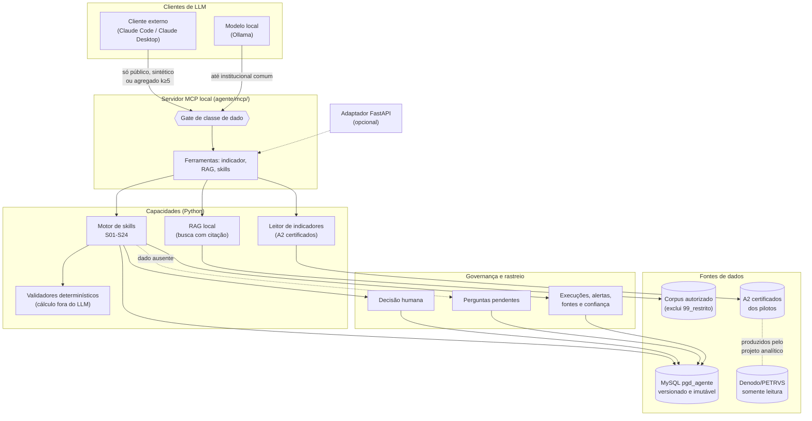

# Proposta de Projeto v7 — Agente PGD/ICMBio

**Projeto:** agente de apoio ao PGD, no monorepo `pgd-icmbio` (pasta `agente/`)  
**Versão:** 7.0  
**Data-base:** 17 de outubro de 2026  
**Situação:** documento de planejamento vigente; substitui a v6 (23/08/2026)  
**Responsável pelo protótipo:** Coordenador de Governança do ICMBio, atuando como desenvolvedor individual  
**Incremento atual:** I0 — Fundação; Fundação técnica (C01–C04) a partir de 02/11/2026  

> [!IMPORTANT]
> Esta proposta e seus capítulos vinculantes substituem integralmente as propostas v1 a
> v6. O que mudou da v6 para a v7 está no [capítulo 09](09-memoria-evolucao.md).
> Decisões humanas, aprovações de fontes e atas reais continuam fora da autoridade deste
> documento e ficam pendentes até manifestação competente.

## 1. Como usar este documento

Esta é a porta de entrada normativa do agente. Ela explica o produto, a arquitetura, o
catálogo S01–S24, o cronograma e os controles essenciais. Detalhes de implementação e
operação estão no [portal da v7](README.md).

| Perfil | Comece por | Depois consulte |
| --- | --- | --- |
| Gestor ou patrocinador | Seções 2, 3, 11 e 15 | [Visão e governança](01-visao-produto-governanca.md) |
| Analista de negócio | Seções 4, 8 e 12 | [Catálogo S01–S24](03-catalogo-skills-s01-s24.md) |
| Desenvolvedor | Seções 7, 9 e 13 | [Arquitetura](02-arquitetura-tecnologia-dados.md) e [qualidade](05-qualidade-testes-aceite.md) |
| Pessoa nova no projeto | Seções 1 a 5 e 15 | [Operação e capacitação](07-operacao-capacitacao.md) |
| Auditor ou encarregado de dados | Seções 10, 13 e 14 | [Segurança, privacidade e fontes](06-seguranca-privacidade-fontes.md) |

### 1.1. Hierarquia e precedência

1. Atos normativos vigentes.
2. Decisões de arquitetura registradas em ADR.
3. Esta proposta.
4. Capítulos vinculantes de `docs/agente/projeto-v7/`.
5. Fichas de `capacidades/fichas/`, geradas de `capacidades/catalogo.yaml`.
6. Anexos técnicos aprovados (AT-01, AT-02).
7. Registros ativos de fontes, riscos, validações, testes e atas.
8. Artefatos metodológicos: a base canônica é `docs/agente/metodologia/` (B01–B04, DP-09);
   os protótipos de `capacidades/prototipos-cowork/` são referência operacional, não
   canônica; os documentos de trabalho antigos foram retirados da árvore e são
   recuperáveis no histórico (ver
   [cobertura dos requisitos](../../governanca-projeto/cobertura-requisitos.md)).

Em caso de conflito, norma prevalece sobre regra institucional; regra institucional sobre
recomendação; e recomendação sobre exemplo. O conflito é registrado em
`regras_conflitos`: RAG ou LLM nunca decide sozinho qual regra aplicar.

Os indicadores OCDE e de gestão seguem a precedência própria do projeto analítico
(decisão CGOV > contratos executáveis > scripts > fichas). O agente consome esses
resultados; não os redefine.

## 2. Sumário executivo

O projeto constrói um agente de IA para apoiar gestores e participantes do Programa de
Gestão e Desempenho no ICMBio. O produto combina três capacidades:

1. **Conhecimento com fonte:** responde questões metodológicas e institucionais por
   recuperação de documentos (RAG), sempre com citação.
2. **Indicadores com dados reais:** serve os 12 indicadores OCDE/PGD e os indicadores de
   gestão G01 e G02 por ferramenta controlada, a partir dos resultados certificados do
   projeto analítico; o modelo de linguagem não estima números.
3. **Regras executáveis:** aplica 24 skills estruturadas ao ciclo de planejamento,
   pactuação, execução, avaliação e aprendizagem do PGD.

O desenvolvimento é individual, com 12 horas brutas por semana e custo incremental zero.
O protótipo é **local-first**: MySQL, ferramentas, RAG e dados institucionais comuns ficam
no computador autorizado. As ferramentas do agente são expostas por um **servidor MCP
local** com gate de classe de dado. Clientes externos (Claude Code, Claude Desktop)
recebem só dado público, sintético ou agregado compartilhável; o conteúdo institucional
comum vai para um modelo local (Ollama). O desenvolvimento usa o Claude Code como
ferramenta principal e o Antigravity como secundária.

O catálogo S01–S24 será entregue em cinco ondas e uma estabilização, em 104 semanas, de
02/11/2026 a 29/10/2028. A Fundação técnica (oito semanas) termina com um fluxo ponta a
ponta pelo servidor MCP; cada onda seguinte termina com um conjunto integrado e testável.

## 3. Contexto, problema e público

O PGD organiza o trabalho por resultados e exige coerência entre competências da unidade,
entregas, metas, capacidade, contribuições individuais, evidências e avaliação. Hoje,
essas decisões dependem de normas distribuídas, orientações, dados do PETRVS, planilhas e
interpretações humanas. O agente deve reduzir esforço e inconsistência sem substituir a
autoridade administrativa.

O agente nasce ao lado de um projeto analítico já em operação: os indicadores OCDE I01–I12
e os indicadores de gestão G01 e G02 são calculados a partir do PETRVS (via Denodo),
validados no protocolo A1–A5 e homologados nas unidades piloto CGOV, COCAGE e GR2. Essa
base dá ao agente números auditáveis desde a Fundação.

### 3.1. Usuários

| Público | Necessidade | Limite do agente |
| --- | --- | --- |
| Chefia da unidade | Elaborar, monitorar e avaliar planos | A chefia confirma toda pactuação ou avaliação |
| Participante | Pactuar trabalho, registrar execução e evidências | O agente não avalia comportamento nem desempenho funcional |
| Analista de negócio | Formalizar regras e validar saídas | O agente não aprova norma nem regra institucional |
| Coordenação de governança | Acompanhar riscos, padrões e conformidade | Relatórios não expõem ranking individual |
| Desenvolvedor | Implementar contratos, integrações e testes | Código não resolve lacuna negocial por suposição |

### 3.2. Três estágios de uso

| Estágio | Usuários | Dados | Compromisso |
| --- | --- | --- | --- |
| Protótipo individual | Desenvolvedor responsável | Públicos, sintéticos e institucionais permitidos, por classe | Sem SLA nem publicação institucional |
| Piloto controlado | CGOV e COCAGE, após autorização | Mínimos e pseudonimizados | Suporte e avaliação delimitados |
| Solução institucional | A definir pelo ICMBio | Conforme governança institucional | Exige identidade, licença, segurança, suporte e aprovação próprios |

## 4. Objetivos e resultados

### 4.1. Objetivo geral

Disponibilizar um agente rastreável que apoie a elaboração, a execução e a avaliação dos
Planos de Entregas e de Trabalho do PGD/ICMBio, integrando conhecimento institucional,
indicadores e regras negociais estruturadas, sem substituir decisões humanas.

### 4.2. Resultados-chave

| ID | Resultado | Evidência de alcance |
| --- | --- | --- |
| RK01 | Respostas metodológicas citam fonte válida | bateria de perguntas com precisão de citação registrada |
| RK02 | Indicadores nunca são inventados pelo modelo | ferramenta lê o A2 certificado; teste DEN-01 contra o CSV oficial |
| RK03 | S01–S24 usam contratos e rastreabilidade comuns | registros de execução e testes de contrato |
| RK04 | Cálculos objetivos são determinísticos | 100% de acerto nas baterias de cálculo |
| RK05 | Histórico de objetos e decisões é preservado | teste de versão, imutabilidade e recuperação |
| RK06 | Dado ausente gera pergunta pendente | casos negativos sem preenchimento silencioso |
| RK07 | Conteúdo não público não sai do ambiente autorizado | gate de classe no servidor MCP e teste negativo SEC em cada gate |
| RK08 | Protótipo individual funciona sem custo incremental obrigatório | inventário de dependências e execução local |
| RK09 | Cada onda entrega valor integrado | gate da onda e demonstração ponta a ponta |
| RK10 | Adoção institucional é separada do protótipo | decisão e checklist próprios antes de publicação |

## 5. Escopo

### 5.1. Dentro do escopo

| Item | Entrada | Saída | Dependência | Estado em 17/10/2026 |
| --- | --- | --- | --- | --- |
| RAG metodológico e institucional | corpus autorizado | resposta com citação | Q5 e indexação | Planejado (C04: allowlist pública) |
| Indicadores OCDE I01–I12, G01 e G02 | A2 certificados dos pilotos | valor, período, escopo e limitações | `lib/liberacao.py` e manifesto do piloto | Cálculo homologado no projeto analítico; ferramenta do agente planejada (C03) |
| Skills S01–S24 | dados estruturados e regras | saída rastreável | ondas 1–5 | Especificadas (fichas 0.2); não implementadas |
| Modelo comum | entidades do PGD | histórico versionado | MySQL e serviço de versões | Fundação parcial (migração `001`) |
| Servidor MCP local | chamadas de ferramenta | contratos com classe do dado | contratos Pydantic | Planejado (C03) |
| Clientes do servidor | Claude Code/Desktop; Ollama | conversa e redação | gate de classe | Planejado (C03–C04) |
| Adaptador FastAPI | solicitações HTTP | contratos JSON | mesmas funções do MCP | Opcional |
| Piloto CGOV/COCAGE | casos autorizados | métricas e feedback | conclusão dos gates | Futuro |

### 5.2. Fora do protótipo

- escrever no PETRVS ou no Denodo;
- recalcular indicador fora do código homologado do projeto analítico;
- tomar decisão administrativa automática;
- resolver conflito normativo por LLM;
- enviar conteúdo institucional, pessoal, sensível ou restrito a cliente ou serviço externo;
- usar plano individual de ferramenta como backend institucional;
- garantir atendimento 24×7 ou suporte institucional;
- substituir avaliação de desempenho funcional;
- publicar o agente para todo o ICMBio sem nova decisão;
- tratar a migração `002` como aplicada antes de sua execução verificada.

## 6. Princípios e regras de ouro

1. Todo objeto tem UUID persistente e código legível.
2. Alteração gera nova versão; a anterior não é sobrescrita.
3. Toda saída automática registra origem, regra e confiança quando aplicável.
4. Decisões humanas são registradas separadamente.
5. Dado ausente vira pergunta pendente.
6. Cálculo determinístico não é delegado ao LLM.
7. Fonte, regra e vigência são separadas do texto gerado.
8. Denodo é somente leitura.
9. Dados pessoais são minimizados e resultados coletivos são agregados.
10. Toda resposta de ferramenta leva a classe do dado; o servidor recusa o que o cliente
    não pode receber.
11. Uma skill só fica pronta após especificação, regras, exemplos, testes,
    implementação, integração e aceite.

## 7. Arquitetura resumida

Leitura textual: os clientes de linguagem conversam com um servidor MCP local. O servidor
expõe as ferramentas (indicador, RAG e skills) e, antes de responder, aplica o gate de
classe: o cliente externo só recebe dado público, sintético ou agregado do produto
compartilhável (k≥5); o modelo local pode receber também o institucional comum; nenhum
cliente recebe `99_restrito`. As ferramentas são funções Python: o RAG recupera só do
corpus autorizado; o motor de skills grava entidades, alertas, perguntas pendentes e
decisões humanas no MySQL, de forma versionada e imutável; o leitor de indicadores serve
os A2 certificados pelo projeto analítico, respeitando a liberação por piloto e nunca
somando pilotos. Um adaptador FastAPI pode expor as mesmas funções, mas não é a base.
Decisões que exigem autoridade humana interrompem o fluxo até confirmação registrada.

### 7.1. Estado atual e estado-alvo

| Elemento | Atual (17/10/2026) | Alvo | Condição |
| --- | --- | --- | --- |
| Banco | MySQL 8.4 no WSL; migração `001`, 21 tabelas, 6 triggers | 33 tabelas, 14 triggers | migração `002` revisada e aplicada no início da Onda 5 |
| Referências Denodo | espelhos sincronizados em 22/08/2026 (816 unidades, 19 usuários piloto) | sincronização controlada | acesso e minimização mantidos |
| Serviço de versões | operacional para o núcleo atual | cobrir entidades futuras | evolução por migração e testes |
| Backup e restauração | dump diário às 19h (timer do systemd), retenção de 14 dias; instância isolada para restauração | manter e testar | restauração comprovada por gate |
| Contratos e motor de skills | não implementados | S01–S24 | C01–C02 e ondas |
| Servidor MCP | não implementado | ferramentas com gate de classe | C03 |
| RAG | não implementado | local, citável e governado | C04 (allowlist pública); Q5 para o institucional |
| Modelo local | não avaliado | Ollama como cliente MCP | spike no C04 |
| Indicadores (projeto analítico) | 14 alvos homologados nos três pilotos | ferramenta do agente sobre os A2 | C03 |

Detalhes: [arquitetura, tecnologia e dados](02-arquitetura-tecnologia-dados.md).

## 8. Catálogo S01–S24

| Onda | Skills | Resultado integrado |
| --- | --- | --- |
| 1 — Fundamentos | S01, S02, S03, S05, S09, S17 | fontes, regras, competências, critérios, estratégia e evidências |
| 2 — Entregas | S04, S06, S07, S08, S10, S20 | catálogo, portfólio, capacidade, cobertura, riscos e integração |
| 3 — Trabalho | S11, S12, S13, S14 | pactuação, acompanhamento e replanejamento |
| 4 — Inteligência | S15, S16, S18, S19 | interunidades, avaliação, relatório e aprendizagem |
| 5 — Execução e avaliação | S21, S22, S23, S24 | ciclo completo de PE e PT |

O catálogo completo, os nomes canônicos e as dependências estão em
[Catálogo S01–S24](03-catalogo-skills-s01-s24.md). A fonte única é
[`capacidades/catalogo.yaml`](../../../capacidades/catalogo.yaml) (DP-09): dela são geradas as
[fichas](../../../capacidades/fichas/README.md), com características e casos para teste em
outras ferramentas de IA, e as tabelas do capítulo 03.

## 9. Interfaces planejadas

Esta proposta documenta contratos futuros; não afirma que já estejam implementados.

### 9.1. Ferramentas do servidor MCP

| Ferramenta | Entrada mínima | Saída |
| --- | --- | --- |
| `indicador` | ID (I01–I12, G01, G02), piloto e data de execução | valor, período, escopo, versão da fórmula, origem do A2, limitações e classe do dado |
| `rag` | pergunta e contexto autorizado | trechos citados, fontes, vigência, alertas e classe do dado |
| `skill` | `skill_id`, `versao_contrato`, `dados` e contexto autorizado | execução, resultado estruturado, alertas, fontes, regras, confiança, perguntas pendentes, decisões requeridas, entidades, erros e classe do dado |

O nome definitivo das ferramentas e dos campos sai dos contratos Pydantic (C01–C02). Um
adaptador FastAPI opcional pode expor as mesmas funções como `POST /skill` e
`GET /indicador/{id}`.

### 9.2. Indicadores

A ferramenta lê o A2 certificado e o manifesto do piloto pedido, respeita
`lib/liberacao.py` e nunca soma resultados de pilotos diferentes. Sem A2 certificado, ou
com o piloto não liberado, a resposta é um erro controlado, nunca uma estimativa. O LLM
não calcula o indicador.

### 9.3. Estados de execução

`recebida`, `validando`, `aguardando_dados`, `aguardando_decisao`, `concluida` e `erro`.
O vocabulário será confirmado nos contratos Pydantic.

## 10. Segurança, privacidade e fontes

| Classe | Processamento local | Modelo local (Ollama) | Cliente ou serviço externo |
| --- | --- | --- | --- |
| Público | Permitido | Permitido | Permitido sob condições vigentes |
| Sintético | Permitido | Permitido | Permitido |
| Agregado compartilhável (k≥5, supressão complementar) | Permitido | Permitido | Permitido |
| Institucional comum | Permitido | Permitido | Não |
| Pessoal | Restrito e minimizado | Só o mínimo, quando a skill exigir | Proibido |
| Sensível | Apenas categoria/impacto necessário | Apenas categoria/impacto | Proibido |
| Sigiloso ou `99_restrito` | Segregado | Proibido | Proibido |

O gate fica no servidor, não nas instruções do cliente. Q5 permanece pendente: uma fonte
só é promovida ao S01 após conferência, validação humana, ata e atualização do índice.
Consulte [Segurança, privacidade e fontes](06-seguranca-privacidade-fontes.md).

## 11. Cronograma-base

Premissas: 12 horas brutas semanais, 8–9 horas efetivas, ciclos de duas semanas, no
máximo duas skills em andamento, revisão a cada quatro ciclos e reserva de 1–2 h por mês
para o ciclo gerencial dos indicadores.

| Etapa | Ciclos | Período | Skills ou resultado |
| --- | --- | --- | --- |
| Fundação | C01–C04 | 02/11–27/12/2026 | contratos, motor mínimo, servidor MCP, indicador, RAG mínimo e M1 |
| Onda 1 | C05–C12 | 28/12/2026–18/04/2027 | S01, S02, S03, S05, S09, S17 |
| Onda 2 | C13–C21 | 19/04–22/08/2027 | S04, S06, S07, S08, S10, S20 |
| Onda 3 | C22–C29 | 23/08–12/12/2027 | S11, S12, S13, S14 |
| Onda 4 | C30–C38 | 13/12/2027–16/04/2028 | S15, S16, S18, S19 |
| Onda 5 | C39–C46 | 17/04–06/08/2028 | S21, S22, S23, S24 |
| Estabilização | C47–C52 | 07/08–29/10/2028 | regressão S01–S24 e piloto controlado |

A grade da v6 foi deslocada nove semanas, porque a Fase A (fechamento da validação dos
indicadores e decisões de arquitetura) ocupou o início previsto da Fundação. Com 8 horas
semanais, a previsão é 30–34 meses; com 20 horas, 15–17 meses. O detalhamento por ciclo
está em [Cronograma, capacidade e marcos](04-cronograma-capacidade-marcos.md).

## 12. Governança e responsabilidades

No protótipo, uma pessoa acumula os papéis de produto, análise, arquitetura,
desenvolvimento e teste, mas cada papel continua separado na documentação para impedir
autoaprovação indevida.

| Atividade | Desenvolvedor individual | Analistas/CGGE | Autoridade competente | TI institucional |
| --- | --- | --- | --- | --- |
| Planejamento e código | Responsável | Consultado | Informado | Consultado |
| Regras e exemplos | Executor provisório | Responsável futuro | Aprova quando cabível | Informado |
| Fonte institucional | Prepara | Valida conteúdo | Aprova Q5 | Apoia acesso |
| Arquitetura local | Responsável | Consultado | Informado | Consultado |
| Adoção institucional | Consultado | Consultado | Responsável | Responsável técnico |

Ferramentas de desenvolvimento: Claude Code (principal) e Antigravity (secundária), com
instruções em `CLAUDE.md` e `PROJECT.md`, pares sem hierarquia e núcleo comum
sincronizado ([ADR-013](../../decisoes/ADR-013-retirada-codex.md)). As duas são ferramentas
de trabalho do desenvolvedor, não componentes do produto.

Ritos: acompanhamento quinzenal, revisão de capacidade a cada quatro ciclos, gate ao final
de cada onda e registro formal de qualquer decisão que altere arquitetura, fonte ou regra.

## 13. Qualidade e definição de pronto

Uma skill percorre sete passos: especificação, formalização de regras, exemplos anotados,
casos de teste, implementação, integração e aceite. Só fica `aprovada` quando todos os
passos, a revisão de privacidade e a documentação operacional estiverem registrados.

Testes abrangem unidade, contrato, integração, regressão, persistência, imutabilidade,
segurança (inclusive o gate de classe), LGPD, RAG, indicadores, ambiguidade, conflito
normativo, autorização, backup e desempenho local. A suíte do repositório roda offline,
no computador e no CI, sem abrir Denodo nem MySQL. Consulte
[Qualidade, testes e aceite](05-qualidade-testes-aceite.md).

## 14. Riscos, decisões e questões

O registro ativo é [`docs/governanca-projeto/riscos.md`](../../governanca-projeto/riscos.md). Os riscos centrais
são alucinação, exposição de dados, conflito normativo, perda de histórico, indisponibilidade
local, sobrecarga individual, expansão de escopo, dependência de validação humana e, na
v7, dependência de fornecedor no desenvolvimento, vazamento pelo cliente externo e
hardware insuficiente para o modelo local (RP34–RP36).

As ADRs 001–014 registram as decisões de arquitetura; as decisões de estrutura e processo
ficam no [registro de decisões do projeto](../../decisoes/registro-decisoes-projeto.md)
(DP-01 a DP-09). Questões abertas nunca são preenchidas como fatos. Q5, validação do
modelo comum, regras institucionais sem fonte e Q18–Q25 continuam visíveis no
[registro de rastreabilidade](08-rastreabilidade-decisoes-riscos.md).

## 15. Estado do projeto em 17/10/2026

**Projeto analítico (base do agente).** Os indicadores OCDE I01–I12 e os de gestão G01 e
G02 estão homologados e certificados nos pilotos CGOV, COCAGE e GR2, com aceites
registrados por piloto. A expansão nacional dos 12 indicadores OCDE e do G01 (produto
restrito) foi deliberada pela CGOV (D36, D42, D44, D45). Os indicadores passam ao modo de
operação: ciclo gerencial mensal, sem fórmula nova, exceto correções.

**Agente — I0, Fundação, em andamento.** No monorepo
`pgd-icmbio` ([ADR-009](../../decisoes/ADR-009-arquitetura-integrada.md)), com o WSL como
ambiente principal:

- MySQL 8.4 com a migração `001` (21 tabelas, 6 triggers) e serviço de versões testado;
- backup diário e instância isolada para restauração e testes de schema;
- espelhos de unidades e usuários piloto sincronizados do Denodo;
- catálogo único `capacidades/catalogo.yaml` com 24 fichas 0.2 especificadas e casos
  sintéticos para teste em outras ferramentas de IA (propostos, não validados pela CGOV);
- ADRs 001–014, com o MCP local como interface-base (ADR-014) e duas ferramentas de
  desenvolvimento (ADR-013).

**Pendente:** contratos comuns, motor de skills, servidor MCP, RAG, modelo local e
S01–S24 (não implementados); migração `002` (não aplicada); Q5 (sem ata); validação
humana do glossário e do modelo comum (até o G1).

**Fase A e B1.** O fechamento da validação dos indicadores, a retirada do Codex, as
decisões de arquitetura (ADR-013 e ADR-014) e a B1 (catálogo único e esta proposta)
foram concluídos em outubro de 2026, antes do C01. A grade não foi antecipada: o C01
começa a B2.

## 16. Gates e marcos

| Gate | Condição mínima |
| --- | --- |
| G0 — Fundação | ambiente reproduzível no WSL, contratos comuns, uma pergunta respondida com citação, um indicador servido igual ao A2, uma execução rastreada no MySQL e teste negativo do gate de classe |
| G1 — Fontes | regras rastreáveis, Q5 tratada sem aprovação fictícia e S01/S02 validadas |
| G2 — Entregas | cálculos exatos, versões preservadas e conformidade rastreável |
| G3 — Trabalho | pactuação e replanejamento sem sobrescrever histórico |
| G4 — Inteligência | inferências sustentadas, amostra adequada e limites explícitos |
| G5 — Avaliação | fatos, regra, sugestão e decisão humana claramente separados |
| G6 — Piloto | regressão completa, privacidade aprovada e uso controlado autorizado |

## 17. Próximas ações

1. C01–C02 (B2): contratos Pydantic comuns, com a classe do dado na resposta; registro de
   skills lido do `catalogo.yaml`; gravação de execuções, perguntas e decisões por
   `agente/dados/versoes.py`.
2. C03 (B3): servidor MCP com a ferramenta `indicador` e o gate de classe; teste DEN-01.
3. C04 (B4): RAG mínimo sobre a allowlist pública, spike do Ollama e teste ponta a ponta;
   G0/M1.
4. Manter Q5 pendente até ata real; especificar S01 e S02 a partir das fichas 0.2.
5. Replanejar a cada quatro ciclos com horas reais.

## 18. Capítulos e anexos vinculantes

| Documento | Conteúdo |
| --- | --- |
| [Portal v7](README.md) | navegação e precedência |
| [01 — Visão e governança](01-visao-produto-governanca.md) | produto, escopo, EAP e RACI |
| [02 — Arquitetura](02-arquitetura-tecnologia-dados.md) | tecnologia, MCP, dados e integrações |
| [03 — Catálogo](03-catalogo-skills-s01-s24.md) | S01–S24 e dependências |
| [04 — Cronograma](04-cronograma-capacidade-marcos.md) | 104 semanas, ciclos e capacidade |
| [05 — Qualidade](05-qualidade-testes-aceite.md) | testes, métricas e aceite |
| [06 — Segurança](06-seguranca-privacidade-fontes.md) | LGPD, classes, gate e fontes |
| [07 — Operação](07-operacao-capacitacao.md) | tutoriais e runbooks |
| [08 — Rastreabilidade](08-rastreabilidade-decisoes-riscos.md) | decisões, riscos e pendências |
| [09 — Evolução](09-memoria-evolucao.md) | memória v1→v7 e o que mudou na v7 |
| [AT-01](../../dados-petrvs/esquema-mysql-agente.md) | esquema PETRVS/MySQL |
| [AT-02](../recursos-local-first.md) | recursos e arquitetura local-first |

## 19. Glossário mínimo

| Termo | Significado |
| --- | --- |
| A2 | CSV de resultado de um indicador, certificado no protocolo A1–A5 |
| ADR | registro de uma decisão de arquitetura e suas consequências |
| CHD | carga horária disponível |
| Gate | ponto de controle que impede avançar sem critérios mínimos |
| Gate de classe | controle do servidor MCP que só entrega a cada cliente as classes de dado permitidas |
| LLM | modelo de linguagem; apoia texto e classificação, não cálculos objetivos |
| MCP | Model Context Protocol: protocolo pelo qual um cliente de LLM chama ferramentas |
| PE | Plano de Entregas da unidade |
| PGD | Programa de Gestão e Desempenho |
| PT | Plano de Trabalho do participante |
| RAG | busca trechos em fontes autorizadas antes de redigir uma resposta |
| Skill | capacidade executável com entradas, regras, saídas e testes definidos |

Glossários completos: [técnico](../../projeto/glossario-tecnico.md) e
[institucional](../../projeto/glossario-institucional.md).

## 20. Critério de vigência

Esta proposta entra em vigor no repositório quando seus capítulos, fichas, ADRs e índices
estiverem presentes e a verificação de links não encontrar dependência ativa da v6.
Alterações futuras devem atualizar a proposta, o capítulo afetado, o registro de
decisões e riscos e o estado operacional do projeto.
