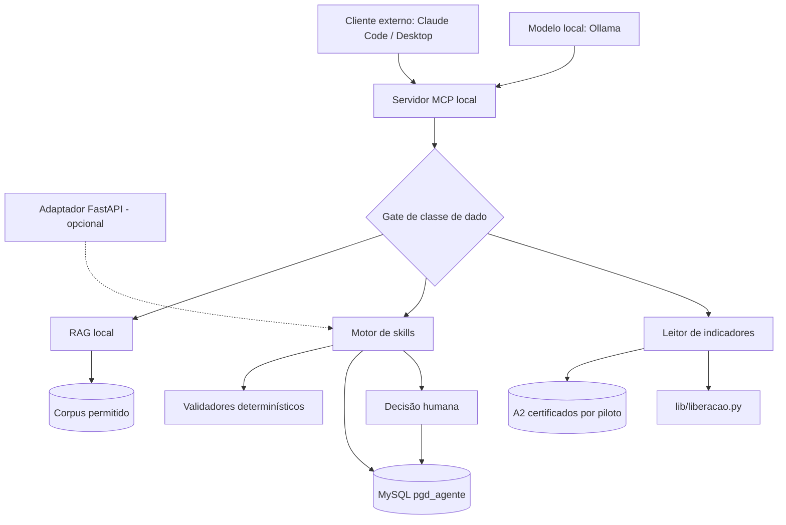

# 02 — Arquitetura, tecnologia e dados

## 1. Visão não técnica

O agente recebe uma pergunta, identifica se precisa consultar documentos, executar uma
regra ou buscar um indicador e devolve uma resposta rastreável. O modelo de linguagem
ajuda a interpretar e redigir; Python faz os cálculos; o MySQL preserva versões; o
projeto analítico fornece os indicadores já certificados; o Denodo fornece dados só para
leitura; e pessoas confirmam decisões. Um servidor local decide o que cada ferramenta de
IA pode receber, conforme a classe do dado.

## 2. Princípios arquiteturais

- local-first durante o protótipo;
- custo incremental obrigatório igual a zero;
- contratos explícitos entre componentes;
- menor quantidade de dados possível;
- classe do dado em toda resposta e gate no servidor, não no cliente;
- escrita versionada apenas por serviços autorizados;
- cálculos determinísticos fora do LLM;
- indicadores lidos do resultado certificado, não recalculados;
- fontes e regras citáveis;
- degradação segura quando uma integração falhar;
- separação entre estado atual e estado-alvo.

## 3. Componentes

Estado em 17/10/2026.

| Componente | Função | Tecnologia/local | Dados | Atual | Alvo | Alternativa/risco |
| --- | --- | --- | --- | --- | --- | --- |
| Servidor MCP | expor ferramentas e aplicar o gate de classe | Python, `agente/mcp/` | contratos e classe | Não criado | indicador, RAG e skills (C03–C04) | gate mal configurado: teste negativo SEC |
| Cliente externo | conversar e redigir com dado público | Claude Code / Claude Desktop | público, sintético, agregado k≥5 | Em uso no desenvolvimento | cliente do servidor | limites do plano individual |
| Modelo local | redigir sobre institucional comum | Ollama | institucional comum | Não avaliado | cliente do servidor (spike C04) | hardware: fallback só determinístico |
| Adaptador HTTP | integração ou demonstração | FastAPI | JSON | Não criado | opcional | não é pré-requisito do G0 |
| Motor de skills | executar S01–S24 | Python/Pydantic | entidades PGD | Não criado | registro lido do `catalogo.yaml` | implementação incremental |
| Validadores | cálculos e invariantes | Python puro | números/datas | Parcial | biblioteca comum | falha se delegado ao LLM |
| RAG | recuperar fontes | local | corpus autorizado | Não criado | busca com citação | resposta sem fonte é recusada |
| Leitor de indicadores | servir I01–I12, G01, G02 | Python sobre os A2 | resultados certificados | Não criado | ferramenta `indicador` (C03) | sem A2 ou sem liberação: erro controlado |
| Banco | persistência | MySQL 8.4 no WSL | modelo comum | 21 tabelas/6 triggers | 33/14 | backup e reconstrução |
| Versões | IDs e histórico | `agente/dados/versoes.py` | entidades | Operacional parcial | cobertura ampliada | nunca inserir manualmente |
| Referências | espelho mínimo do PETRVS | `agente/dados/sincronizar_ref.py` | unidades e usuários piloto | Sincronizado em 22/08/2026 | sincronização controlada | sem CPF nem e-mail |
| Backup | recuperação | `backup.sh` + timer do systemd | dump MySQL | Diário às 19h, 14 dias | manter e testar restauração | instância isolada para restaurar |
| Observabilidade | auditoria | logs + banco | metadados | Parcial | correlação por execução | não registrar conteúdo sensível |

## 4. Diagrama de componentes

## 5. Fluxos de dados

### 5.1. Fonte para regra

`documento → classificação → fonte institucional → versão/vigência → regra extraída →
validação humana → uso pela skill`.

Se houver conflito, a regra fica associada a `regras_conflitos`; o usuário recebe o
alerta e a questão pendente.

### 5.2. Execução de skill

`chamada de ferramenta → validação do contrato → leitura de entidades/fontes → cálculo
ou classificação → alertas/perguntas → decisão humana quando exigida → persistência do
rastreio → classificação da resposta → gate → resposta`.

### 5.3. Indicador

`ID, piloto e data de execução → manifesto do piloto → verificação de liberação
(lib/liberacao.py) → leitura do A2 certificado → metadados (período, escopo, versão da
fórmula, origem) → classificação → gate → resposta`.

O agente não consulta o Denodo para recalcular indicador nem soma pilotos. O cálculo
continua no projeto analítico, validado em A1–A5. Sem A2 certificado ou sem liberação, a
resposta é um erro controlado.

### 5.4. Gate de classe

`resposta da ferramenta → classe do conteúdo → cliente que pediu → permitido? → entrega
ou recusa com erro controlado e log sem conteúdo`. Cliente externo recebe só público,
sintético ou agregado compartilhável (k≥5, supressão complementar); o modelo local recebe
até institucional comum; ninguém recebe `99_restrito`.

### 5.5. Versão de entidade

`objeto existente → leitura da versão atual → proposta de alteração → decisão humana →
nova versão → atualização do ponteiro`. A versão anterior permanece imutável.

### 5.6. Execução e avaliação

`PE/PT pactuado → registro de execução → evidências → validações → avaliação proposta →
decisão da chefia → notificação/recurso quando aplicável → nova versão`.

## 6. Modelo comum

### 6.1. Grupos atuais

| Grupo | Tabelas principais | Finalidade |
| --- | --- | --- |
| Controle | `schema_migracoes` | saber o esquema aplicado |
| Governança | `execucoes_skill`, `decisoes_humanas`, `perguntas_pendentes` | rastreabilidade e autoridade |
| Referências | `ref_unidades`, `ref_usuarios` | espelho mínimo do Denodo |
| Institucional | fontes, regras, versões, conflitos | proveniência e vigência |
| Portfólio | candidatas, entregas e versões | catálogo e histórico |
| Capacidade | planos, participantes, indisponibilidades, alocações | cálculo e cobertura |
| Estratégia/risco | objetivos, resultados, vínculos e riscos | encadeamento e restrições |

### 6.2. Regras de persistência

- PK `CHAR(36)` com UUID.
- Código legível para comunicação humana.
- `created_at`, `updated_at` e `deleted_at` conforme o tipo de entidade.
- Versões são INSERT-only.
- Escrita versionável somente por `agente/dados/versoes.py`.
- Funções recebem conexão e não fazem `commit`; o chamador controla a transação.
- Testes de escrita usam rollback ou a instância isolada.

### 6.3. Estado-alvo da migração `002`

A migração acrescentará o bloco de execução, evidência, avaliação, recurso e
desenvolvimento. Ela continua **planejada e não aplicada**; a revisão e a aplicação estão
no início da Onda 5 (C39). A aceitação exige revisão do SQL, backup, teste de restauração
na instância isolada, contagem 33/14, imutabilidade e smoke test com rollback.

## 7. Contrato comum planejado

Os contratos Pydantic são definidos no C01–C02 e valem para todas as ferramentas.

### Entrada

| Campo | Obrigatório | Regra |
| --- | :---: | --- |
| `skill_id` | Sim, para skill | S01–S24 existente no `catalogo.yaml` |
| `versao_contrato` | Sim | versão suportada |
| `dados` | Sim | validado pelo contrato da skill ou da ferramenta |
| `contexto` | Não | somente dados autorizados e necessários |
| `entidades_relacionadas` | Não | IDs persistentes, nunca cópias arbitrárias |

### Saída

| Campo | Função |
| --- | --- |
| `execucao_id` | correlacionar logs e persistência |
| `skill_id`/`versao` | reproduzir comportamento |
| `status` | indicar conclusão, espera ou erro |
| `classe_dado` | classe do conteúdo, usada pelo gate |
| `resultado` | saída tipada da skill ou da ferramenta |
| `alertas` | inconsistências e limitações |
| `regras_aplicadas` | códigos, versões e justificativas |
| `fontes` | proveniência e trechos citados |
| `confianca` | apenas quando houver inferência semântica |
| `perguntas_pendentes` | dados que faltam |
| `decisoes_requeridas` | escolhas reservadas a pessoas |
| `entidades_relacionadas` | IDs do modelo comum |
| `erros` | código estável e mensagem segura |

## 8. Denodo, PETRVS e projeto analítico

- O Denodo é somente leitura, configurado num ponto só (`lib/denodo_config.py`).
- O agente usa o Denodo para os espelhos de referência e, a partir da Onda 2, para a
  leitura do PETRVS pelo S20; indicadores vêm dos A2 certificados.
- VQL com prefixo `petrvs_icmbio_`, `deleted_at IS NULL` em toda relação e datas com
  `CAST(... AS DATE)`; cálculos finais em Python.
- Nenhum CPF ou e-mail no espelho do piloto.
- Indisponibilidade gera erro controlado, nunca estimativa.
- Fronteira ([ADR-009](../../decisoes/ADR-009-arquitetura-integrada.md)): o agente pode
  usar o núcleo analítico; o núcleo não importa `agente`, `pymysql` nem `anthropic`.

## 9. RAG

O pipeline planejado executa inventário, classificação, extração/OCR, fragmentação,
metadados, indexação local, recuperação, citação e avaliação. Cada fragmento preserva
fonte, versão, vigência, classe de acesso e natureza. `99_restrito` é excluído por padrão.
O RAG mínimo do C04 usa só a allowlist pública de
[fontes institucionais](../../governanca-projeto/fontes-institucionais.md); o corpus
institucional depende da Q5.

## 10. Recursos disponíveis

| Recurso | Uso permitido no projeto | Não presumir |
| --- | --- | --- |
| Claude Code (principal) e Antigravity (secundário) | desenvolvimento e revisão; cliente externo do servidor MCP com dado permitido | créditos de API, publicação multiusuário ou serviço institucional |
| Ollama e modelos abertos | redação local sobre institucional comum | qualidade ou desempenho sem o spike do C04 |
| Microsoft 365 E3 | produtividade e identidade disponíveis ao usuário | todos os recursos premium do tenant |
| Power Apps Premium | experimento individual de interface | distribuição institucional automática |
| Copilot Studio Viral Trial | prova temporária | publicação governada e duradoura |
| Fabric Free e Power Automate (licença gratuita) | experimentos individuais | capacidade organizacional ou automação premium |

Análise completa: [AT-02](../recursos-local-first.md).

## 11. Falhas e degradação segura

| Falha | Comportamento |
| --- | --- |
| MySQL indisponível | não escrever; informar indisponibilidade e orientar recuperação |
| A2 ausente ou piloto não liberado | não responder o indicador; erro controlado |
| Denodo indisponível | não sincronizar; manter o último espelho e registrar a data |
| Fonte ausente | criar pergunta pendente |
| Fonte conflitante | apresentar conflito e exigir decisão |
| Cliente externo indisponível | usar o modelo local ou suspender a tarefa sem perder dados |
| Modelo local insuficiente | manter o institucional só nas ferramentas determinísticas |
| Contrato incompatível | rejeitar com erro de versão |
| Classe acima do permitido ao cliente | recusar no servidor e registrar sem conteúdo |
| Dado classificado incorretamente | interromper envio externo e registrar incidente |

## 12. Decisões relacionadas

- ADR-002: Denodo somente leitura.
- ADR-003: arquitetura de capacidades.
- ADR-004: modelo de linguagem substituível (estratégia de fornecedor revisada pela ADR-014).
- ADR-005: stack RAG.
- ADR-006: MySQL.
- ADR-007: execução e avaliação.
- ADR-008: estratégia individual local-first e catálogo em ondas (item 7 revisado pela ADR-014).
- ADR-009: arquitetura integrada do monorepo.
- ADR-012: configuração única do Denodo.
- ADR-013: duas ferramentas de desenvolvimento.
- ADR-014: servidor MCP local e arranjo híbrido.

Detalhes do esquema: [AT-01](../../dados-petrvs/esquema-mysql-agente.md).
